<p align="center">
  
</p>

<h1 align="center">ParkWise</h1>

<p align="center"><b>Smart parking for housing societies.</b><br>
Find a slot, pay online, drive in through a QR gate. Guards scan, overstays are charged automatically.</p>

<p align="center">
  <a href="https://github.com/08pranav/parkwise-platform/actions/workflows/ci.yml"></a>
  
  
  
</p>

<p align="center">
  <a href="https://parkwise-alpha.vercel.app"><b>Try the live demo</b></a> ·
  <a href="https://github.com/08pranav/parkwise-platform/releases/latest"><b>Download APKs</b></a> ·
  <a href="#demo-video"><b>Watch the demo</b></a> ·
  <a href="https://parkwise-api-77gc.onrender.com/api/docs/">API docs (Swagger)</a> ·
  <a href="docs/EDGE_CASES.md">Edge cases we solved</a>
</p>

> **Public demo, test payments only.** Data resets nightly. The API runs on a free tier, so the first request after a
> quiet period can take about a minute. Use the **Try as ...** button on each login screen.

## The problem

Parking in a housing society is run on goodwill and a paper register:

- Slots sit empty while visitors circle the block, because nobody knows what is free.
- Gates back up while a guard checks names against a notebook.
- Disputes over who stayed how long, and who owes what, have no record to settle them.
- Residents who rent out a spare slot have no safe way to do it.

## What ParkWise does

Residents and visitors search for a society near their destination, see a live, surge-priced quote, book a slot
for a time window and pay with Stripe or Razorpay. They get a signed QR code. At the gate the guard scans it:
the booking is checked against the society, the time window and its payment, entry is logged, and a second scan of
the same code is refused. If the car leaves late, the overstay penalty is calculated and charged. Society admins
approve residents and slots, owners list spare slots, and a super admin onboards societies and issues refunds.

## Screenshots

<p>
  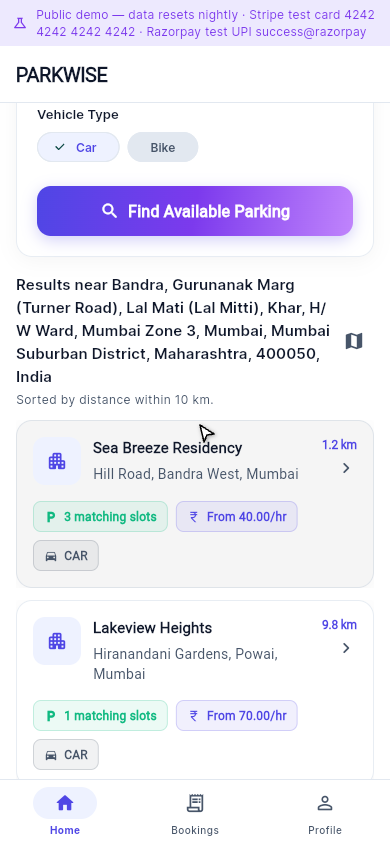
  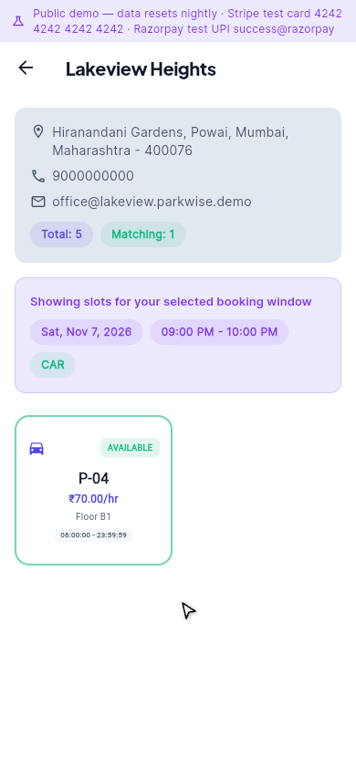
  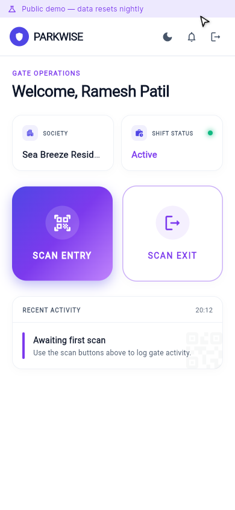
  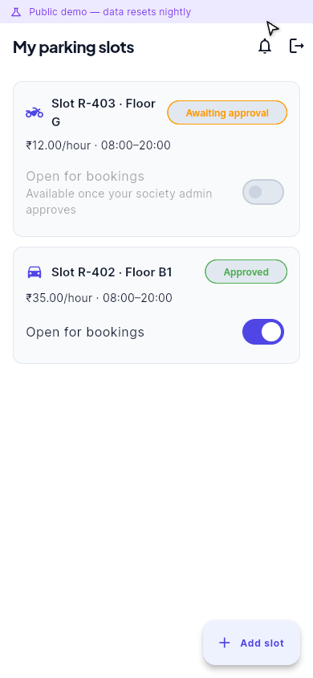
</p>
<p>
  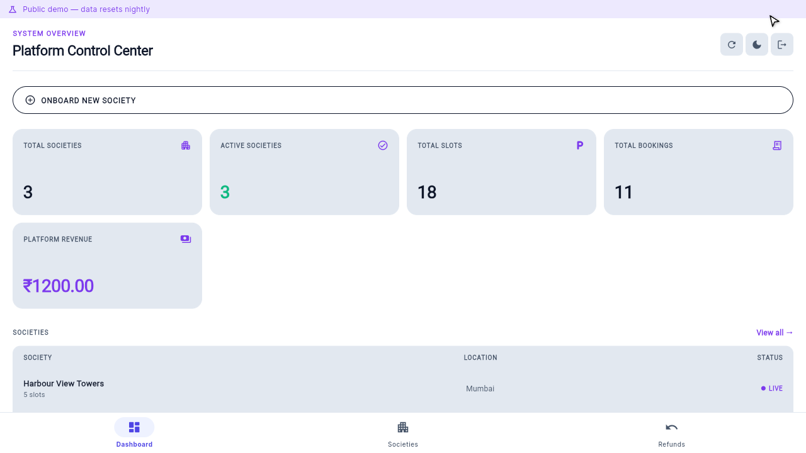
  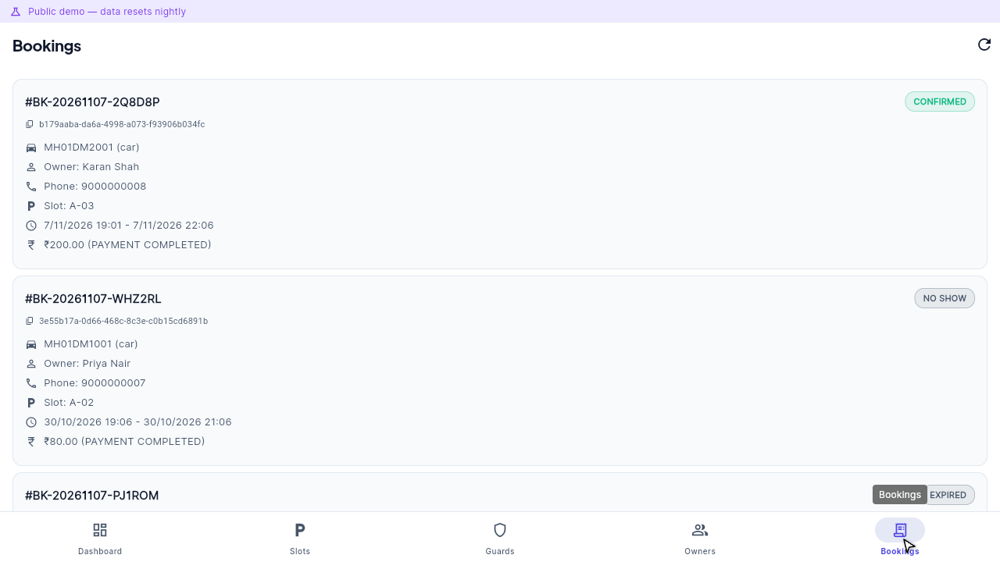
</p>

More in [docs/screenshots/](docs/screenshots), taken from the live demo with fictional data.

## Demo video

The phone apps are shown on phone-sized screens; the landing page and super admin are shown on a desktop screen.

<p>
  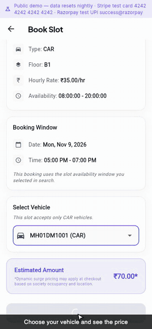
  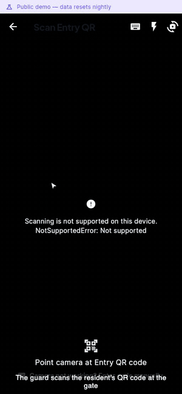
  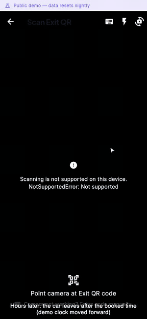
  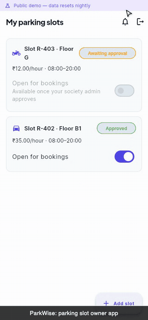
</p>
<p>
  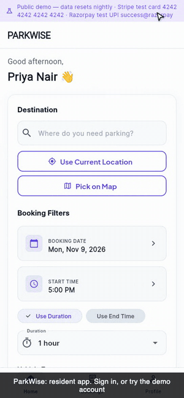
  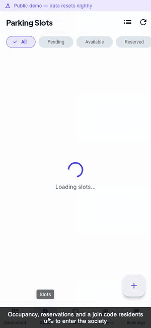
  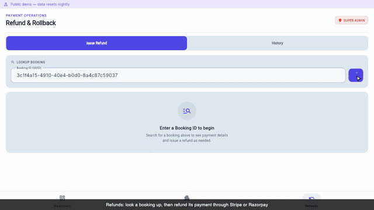
</p>

- **Full walkthrough (8 min, 1080p):** [ParkWise-full-wide.mp4](https://github.com/08pranav/parkwise-platform/releases/download/v1.0.0/ParkWise-full-wide.mp4)
- **Highlights (about 80 s):** [16:9](https://github.com/08pranav/parkwise-platform/releases/download/v1.0.0/ParkWise-highlight-wide.mp4) ·
  [square](https://github.com/08pranav/parkwise-platform/releases/download/v1.0.0/ParkWise-highlight-square.mp4) ·
  [vertical](https://github.com/08pranav/parkwise-platform/releases/download/v1.0.0/ParkWise-highlight-tall.mp4)

| Time | Chapter |
|---|---|
| 00:03 | Meet ParkWise |
| 00:24 | Sign in |
| 00:54 | Resident: book, pay, get a QR |
| 02:37 | Guard: scan in, scan out |
| 04:24 | Slot owner |
| 05:09 | Society admin |
| 06:23 | Super admin: refunds |

Recorded from the live site. The recording browser has no camera, so the guard enters the QR text with the app's
manual-entry dialog, and the demo-only fast-forward endpoint moves a booking's clock so an overstay can be shown
without waiting. Payments are Stripe test mode.

## Roles and features

| Resident / visitor (`user_app`) | |
|---|---|
| Search | Destination search with autocomplete, societies sorted by distance with free slots and starting price |
| Quote | Per-hour price with a surge breakdown (own-society occupancy and nearby demand) |
| Book and pay | Choose slot and window, add a vehicle, pay with Stripe (embedded checkout) or Razorpay |
| Gate | QR code, with a "copy code" fallback for manual entry |
| After the stay | Booking history, cancel, pay overstay penalties, notification inbox |
| Extras | Vehicles, light and dark themes, biometric sign-in |

| Slot owner (`owner_app`) | |
|---|---|
| List a slot | Number, floor, car or bike, rate and daily availability hours |
| Approval | See pending, approved or rejected status with the admin's note |
| Control | Open or close an approved slot for bookings, notifications inbox |

| Society admin (`admin_app`) | |
|---|---|
| Residents and slots | Approve join requests and resident slots, block or unblock slots |
| Inventory | Slots with availability windows, owners, society bookings, dashboard |
| Gate staff | Add guards with credentials and grant entry/exit scan rights |

| Guard (`guard_app`) | |
|---|---|
| Scan | Camera scan or manual code entry for entry and exit |
| Result | Booking, vehicle, payment status and overstay result; denied scans explain why |

| Super admin (`super_admin_app`) | |
|---|---|
| Platform | Societies (create, edit, map location), payments overview |
| Refunds | Look up a booking, review its payment, refund in full or in part |

## Architecture

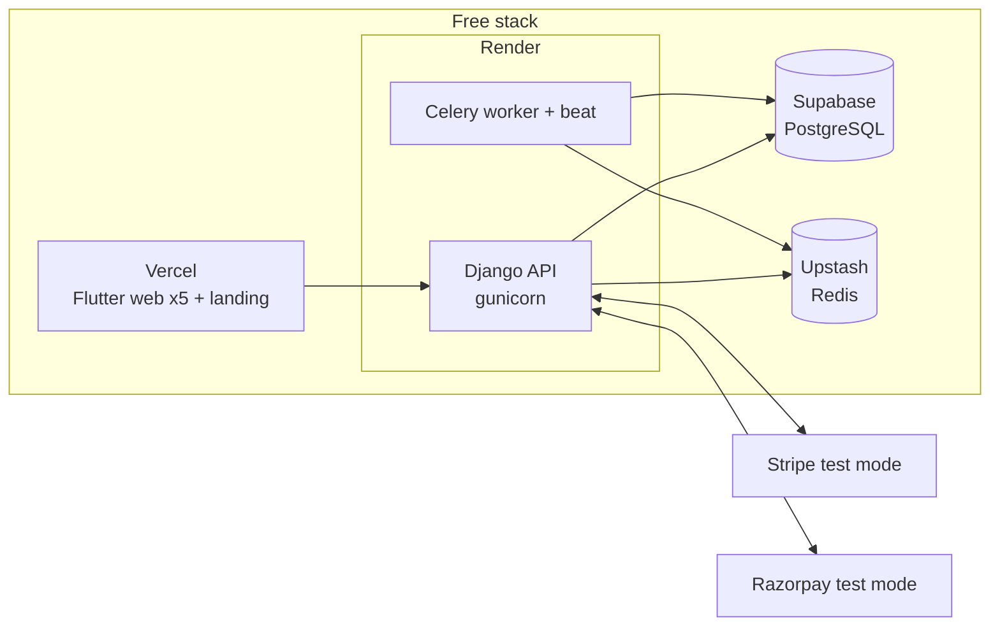

More: [booking flow and state machine](docs/ARCHITECTURE.md) · [deployment and free-tier limits](docs/DEPLOYMENT.md).

## Engineering highlights

These are the problems that turned out to be the real work. Each has a test; details in
[docs/EDGE_CASES.md](docs/EDGE_CASES.md).

- **No double bookings.** Eight simultaneous requests for one slot produce exactly one booking (row lock, proven by a concurrency test that fails without the lock).
- **A booking cannot reach an impossible state.** One transition table; every status change goes through it.
- **Webhooks you can trust.** Signed, fail-closed, deduplicated by event id, safe against out-of-order delivery; a payment that arrives after its booking expired revives the booking or is refunded automatically.
- **Refunds that cannot double-spend.** Amount reserved under a lock, gateway called with an idempotency key, every attempt audited.
- **QR replay protection.** One entry per booking; forged, stale, early, late and wrong-society scans are refused and logged.
- **Deterministic surge pricing.** Pure `Decimal` functions with every tier boundary tested.
- **Time zones and midnight.** Stored in UTC, shown in IST; availability windows split at local midnight; overstay rounded up and penalised once per booking.

## Tech stack

| Layer | Choice |
|---|---|
| API | Django 6, Django REST Framework, SimpleJWT, drf-spectacular |
| Background jobs | Celery with beat, Redis |
| Database | PostgreSQL |
| Payments | Stripe and Razorpay (test mode) |
| Apps | Flutter (web and signed Android APKs), bloc/cubit, go_router, Dio, json_serializable, one shared `core` package |
| Hosting | Supabase, Upstash, Render, Vercel (all free tiers) |
| Quality | pytest + factory_boy, ruff, `flutter analyze --fatal-infos`, gitleaks, GitHub Actions |

## Repository layout

```
backend/                 Django project (apps: accounts, societies, bookings, payments, penalties, qr_validation, admin_api)
mobile/apps/             user_app, owner_app, admin_app, guard_app, super_admin_app
mobile/packages/core/    shared API client, auth, models, theme, widgets, bootstrap
web/landing/             landing page for the demo site
scripts/                 deploy, web build, API-docs generator, live smoke test
docs/                    architecture, deployment, edge cases, API reference
```

## Run it locally

```sh
make install     # backend and Flutter dependencies
make dev         # PostgreSQL + Redis in Docker, migrations, API on http://127.0.0.1:8000
cd backend && python manage.py seed_demo      # demo data (optional)

cd mobile/apps/user_app
flutter run -d chrome --dart-define=API_BASE_URL=http://127.0.0.1:8000 --dart-define=DEMO_MODE=true
```

See [CONTRIBUTING.md](CONTRIBUTING.md) for the full workflow.

## Android apps

Signed release APKs for all five apps are on the [v1.0.0 release](https://github.com/08pranav/parkwise-platform/releases/tag/v1.0.0) (with SHA-256 checksums).
They point at the demo API and have demo mode on. `scripts/build-apks.sh` rebuilds them.

## Demo accounts and test payments

All accounts use the password `Demo@12345`.

| Role | Email | App path |
|---|---|---|
| Resident | `user@parkwise.demo` | `/user/` |
| Slot owner | `owner@parkwise.demo` | `/owner/` |
| Society admin | `admin@parkwise.demo` | `/admin/` |
| Guard | `guard@parkwise.demo` | `/guard/` |
| Super admin | `super@parkwise.demo` | `/super-admin/` |

- **Stripe:** card `4242 4242 4242 4242`, any future expiry, any CVC.
- **Razorpay:** test-mode checkout, UPI id `success@razorpay`.

## Tests and CI

- **Backend:** 238 pytest tests on PostgreSQL; 96.6% line coverage of the `services.py` modules (74% of the whole backend).
- **Flutter:** 40 unit and widget tests across the shared package and the five apps; `flutter analyze --fatal-infos` is clean in every package.
- **CI** (GitHub Actions): ruff, pytest with Postgres and Redis, production-settings deploy checks, Flutter format/analyze/test/web build, and a gitleaks scan of the full history on every pull request.
- **Live smoke test:** `scripts/smoke-live.mjs` signs in as every role on the deployed site, pays with a real Stripe test card in a headless browser, scans in, replays the scan, forces an overstay, and refunds, 31 checks.

## API

The reference is generated from the OpenAPI schema: [docs/API_DOCUMENTATION.md](docs/API_DOCUMENTATION.md)
(55 paths, 71 operations). The running API serves Swagger UI at `/api/docs/`.

## Roadmap

- Wallet balance and OTP password reset.
- Break up the largest Flutter screens into feature folders (`home_screen`, `refund_screen`, `booking_detail_screen` are still 1,400 to 2,200 lines).
- Describe every endpoint's request and response in the OpenAPI schema (some views have no serializer yet).
- Real-money payments need live keys, tax invoices and a production database plan.

## Team

Built by three SDE interns at **Specter Technology and Games Pvt. Ltd.** (February to June 2026), with equal
contributions from everyone:

- **Pranav Koradiya**: [github.com/08pranav](https://github.com/08pranav)
- **Santo Xavier**: [github.com/SAnto-spec](https://github.com/SAnto-spec)
- **Junaid Momin**: [github.com/junaidjmomin](https://github.com/junaidjmomin)

Thank you to our mentor, **Dr. Sanket Jack**, for the guidance throughout the internship.

Originally developed at `Parkingapp-crce/Parkingapp` during our internship.

## License

MIT. See [LICENSE](LICENSE).
