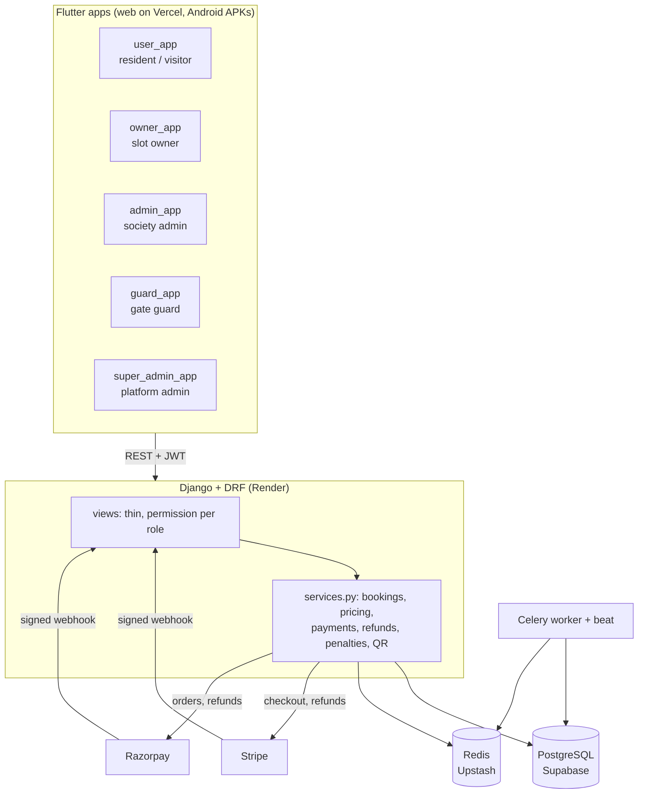
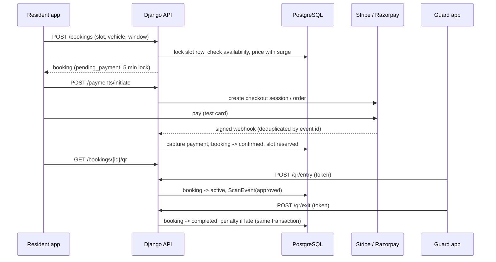
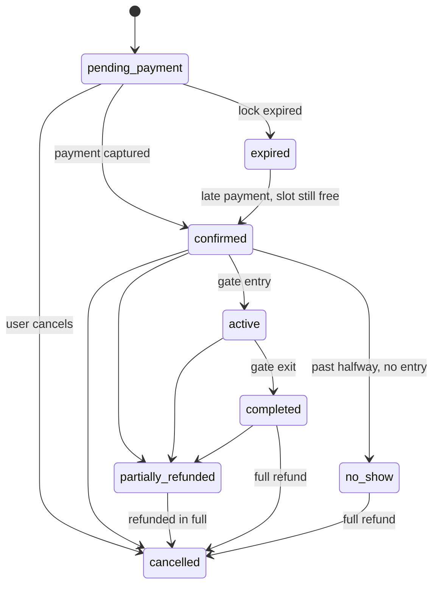

# Architecture

## Overview

The five apps share one Dart package, `mobile/packages/core`: API client and endpoints, models
(`json_serializable`), the auth bloc and secure token storage, theme, common widgets, and the
`setupCoreDependencies` bootstrap. The API origin is a compile-time value
(`--dart-define=API_BASE_URL`), so the same code runs against localhost, staging or production.

## Backend layout

| App | Responsibility |
|---|---|
| `accounts` | User (roles: user, society_admin, guard, super_admin), vehicles, notifications, JWT login, guard credentials, role permissions |
| `societies` | Societies, parking slots (society or resident owned, approval workflow), availability windows, search and geocoding |
| `bookings` | Booking model, **state machine**, **pricing**, availability and booking services, Celery tasks (expiry, no-show) |
| `payments` | Stripe and Razorpay checkout/orders, idempotent webhooks, capture, refunds, `PaymentEvent` audit log |
| `penalties` | Overstay penalty calculation and creation |
| `qr_validation` | Signed QR tokens, entry/exit validation, `ScanEvent` log |
| `admin_api` | Dashboards, refund lookup and refund endpoints, demo seed/reset |

Views stay thin: they validate input, check the role and call a function in `services.py`. Business rules
(and the transactions and row locks that protect them) live in services so they can be unit tested without HTTP.

## Roles

| Role | Can do |
|---|---|
| Resident / visitor (`user`) | Search, book, pay, view QR, cancel, pay penalties, manage vehicles; may also list their own slot (owner) |
| Society admin | Approve residents and slots, manage slots and availability windows, add guards, see society bookings |
| Guard | Scan entry and exit for their own society, only if granted scan rights |
| Super admin | Onboard societies, platform dashboard, look up bookings and issue full or partial refunds |

## Booking and payment flow

## Booking states

## Data model (main tables)

`User` → `Vehicle`; `Society` → `ParkingSlot` → `SlotAvailabilityWindow`; `Booking` (user, vehicle, slot) →
`Payment` → `Refund`; `Booking` → `Penalty` (one per booking, enforced by the database);
`Booking` → `ScanEvent`; `PaymentEvent` stores each webhook delivery under a unique `(provider, event_id)`.

## Time

All timestamps are stored in UTC. Availability windows are wall-clock times in the project zone
(Asia/Kolkata), and apps display IST. Window checks convert to local time and split at midnight.

Deployment and free-tier limits: [DEPLOYMENT.md](DEPLOYMENT.md). Failure modes and tests: [EDGE_CASES.md](EDGE_CASES.md).
