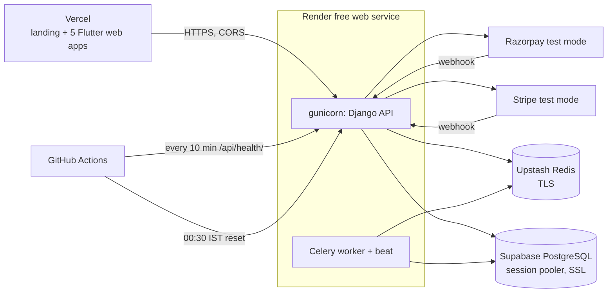

# Deployment

ParkWise runs entirely on free tiers: Supabase (PostgreSQL), Upstash (Redis), Render (API and
Celery worker), Vercel (web apps and landing page). Payments are Stripe and Razorpay in **test mode**.



## Services and what they hold

| Service | Role | Free-tier limits worth knowing |
|---|---|---|
| Supabase | PostgreSQL, reached through the session pooler with SSL required | Projects pause after a week of inactivity; 500 MB database |
| Upstash | Redis broker and result store for Celery (`rediss://`) | Daily command quota; the 60-second sweep and 5-minute no-show task use a small share |
| Render | One free web service runs gunicorn **and** a Celery worker with beat (`honcho`), because the free plan has no background workers | 750 instance hours per workspace per month; the service sleeps after 15 minutes without traffic, so the first request after a sleep takes about a minute |
| Vercel | Static hosting for the landing page and the five Flutter web builds, SPA fallbacks per sub-path | Hobby plan |
| GitHub Actions | CI, nightly demo reset, keep-warm ping, web deploy | Free minutes for public repositories |

## Environment variables

Names only. Values live in `.env.deploy` (git-ignored) and in the Render dashboard.

**API (Render)**

| Variable | Purpose |
|---|---|
| `DJANGO_SETTINGS_MODULE` | `parking_platform.settings.production` |
| `PYTHON_VERSION` | `3.13.0` |
| `SECRET_KEY`, `QR_SIGNING_SECRET` | Django secret and the key that signs QR tokens (required in production) |
| `ALLOWED_HOSTS` | `.onrender.com` |
| `CORS_ALLOWED_ORIGINS`, `CSRF_TRUSTED_ORIGINS` | The Vercel site origin |
| `FRONTEND_BASE_URL` | Where Stripe returns the browser after checkout |
| `DB_HOST`, `DB_PORT`, `DB_NAME`, `DB_USER`, `DB_PASSWORD` | Supabase session pooler (or a single `DATABASE_URL`) |
| `REDIS_URL` | Upstash; `redis://` is upgraded to `rediss://` automatically |
| `STRIPE_SECRET_KEY`, `STRIPE_PUBLISHABLE_KEY`, `STRIPE_WEBHOOK_SECRET` | Stripe test mode |
| `RAZORPAY_KEY_ID`, `RAZORPAY_KEY_SECRET`, `RAZORPAY_WEBHOOK_SECRET` | Razorpay test mode |
| `MAPTILER_API_KEY` | Location search |
| `DEMO_MODE` | `true` enables the demo reset and fast-forward endpoints |
| `DEMO_RESET_TOKEN` | Bearer token for `POST /api/v1/admin/reset-demo/` |

**Web build (compile-time `--dart-define`)**: `API_BASE_URL`, `DEMO_MODE`, `MAPTILER_API_KEY`.

**GitHub Actions secrets**: `API_URL`, `DEMO_RESET_TOKEN`, `VERCEL_TOKEN`, `MAPTILER_API_KEY`,
`VERCEL_ORG_ID`, `VERCEL_PROJECT_ID`.

## Webhooks

| Provider | URL | Events | Secret |
|---|---|---|---|
| Stripe | `<api>/api/v1/payments/webhook/` | `checkout.session.completed`, `checkout.session.async_payment_succeeded`, `payment_intent.payment_failed` | `STRIPE_WEBHOOK_SECRET` |
| Razorpay | `<api>/api/v1/payments/razorpay/webhook/` | `payment.captured`, `payment.failed`, `order.paid` | `RAZORPAY_WEBHOOK_SECRET` |

Both endpoints verify the signature over the raw body, refuse to run without a configured
secret, and record each event id so redeliveries are ignored.
Stripe's endpoint is created with the Stripe API. Razorpay's webhook is added once in the dashboard
(Test mode, Settings, Webhooks, Add new webhook).

## Redeploying

```sh
scripts/deploy.sh          # API and web
scripts/deploy.sh api      # sync Render env vars and redeploy the API
scripts/deploy.sh web      # rebuild the Flutter web apps and redeploy Vercel
```

Pushes to `main` redeploy the API automatically (Render auto-deploy) and, when `mobile/` or
`web/` change, the `deploy-web` workflow rebuilds and redeploys Vercel.

## Demo data

`python manage.py seed_demo [--reset]` loads three fictional Mumbai societies, one account per
role (all `@parkwise.demo`, password `Demo@12345`), and bookings in every state.
The `demo-reset` workflow calls `POST /api/v1/admin/reset-demo/` nightly at 00:30 IST.
The `keep-warm` workflow pings `/api/health/` every 10 minutes so the free service rarely sleeps.

## Known limits

- Test-mode payments only; no real money moves.
- After a long idle period the first request can take about a minute (free-tier cold start).
- Redis and database quotas are those of the free plans.
